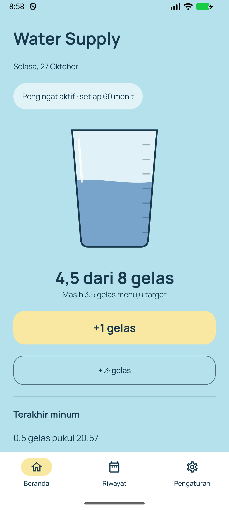
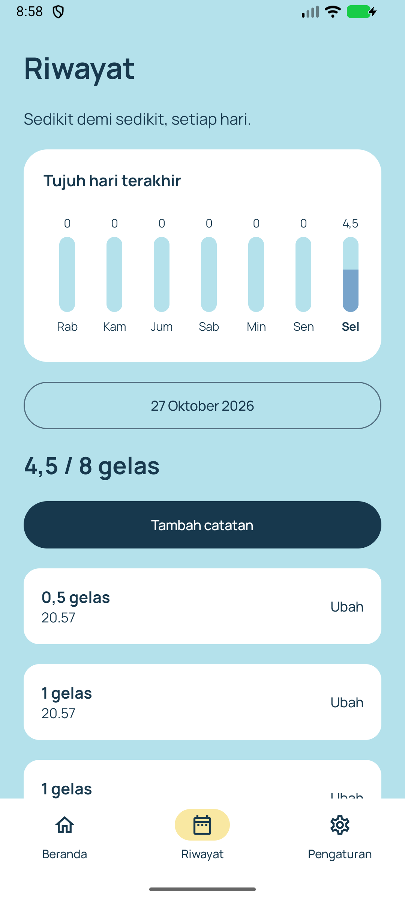
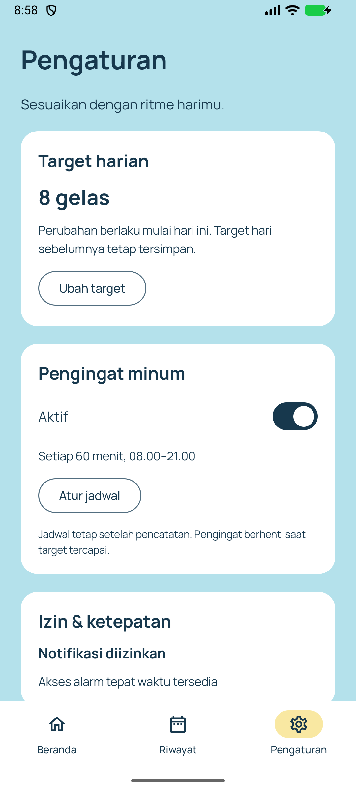

# Water Supply

Catat minum, pantau progres, dan bangun kebiasaan hidrasi setiap hari. Aplikasi Android berbahasa Indonesia yang bekerja sepenuhnya offline, tanpa akun atau iklan.

## Tampilan

Screenshot dari emulator Android dengan contoh catatan minum.

<table>
  <tr>
    <th>Beranda</th>
    <th>Riwayat</th>
    <th>Pengaturan</th>
  </tr>
  <tr>
    <td></td>
    <td></td>
    <td></td>
  </tr>
</table>

## Fitur

- Catat **1 atau ½ gelas** dari aplikasi maupun widget layar utama.
- Pantau target harian dan grafik tujuh hari; tambah, ubah, atau hapus catatan minum.
- Atur pengingat berdasarkan interval atau jam khusus. Pengingat dijeda saat target tercapai.
- Semua data tersimpan di perangkat. Menghapus data aplikasi atau uninstall akan menghapus catatan.

## Menjalankan

Memerlukan **Android 7.0+ (API 24)**. Buka proyek di Android Studio, gunakan JDK bawaan, sinkronkan Gradle, lalu jalankan konfigurasi `app`.

```powershell
./gradlew.bat :app:assembleDebug
```

APK tersedia di `app/build/outputs/apk/debug/app-debug.apk`.

Untuk menjalankan pemeriksaan dan tes perangkat (emulator/perangkat harus terhubung):

```powershell
./gradlew.bat :app:testDebugUnitTest :app:lintDebug
./gradlew.bat :app:connectedDebugAndroidTest
```

Uji startup **APK release bertanda tangan** juga, karena tes debug tidak menjalankan
optimasi R8. Gunakan emulator khusus pengujian: skrip ini menghapus instalasi dan
data Water Supply pada emulator yang dipilih, lalu memeriksa fresh install serta
cold relaunch. Jalankan setidaknya pada Android 16 (API 36).

```powershell
python scripts/check-release-startup.py --serial emulator-5556 --apk path/to/signed-release.apk
```

Tambahkan `--adb path/to/adb.exe` jika `adb` belum ada di PATH.

Dibangun dengan **Kotlin · Jetpack Compose · Material 3 · Room · DataStore · Glance**.

CI membangun dan memeriksa setiap push ke `main` serta pull request. Release APK bertanda tangan diterbitkan melalui tag `v*` yang cocok dengan `versionName`; konfigurasi ada di [workflow release](.github/workflows/release.yml).

> Pengingat memerlukan izin notifikasi dan akses alarm agar tepat waktu. Penghematan baterai Android dapat menunda pengingat serta pembaruan widget.
